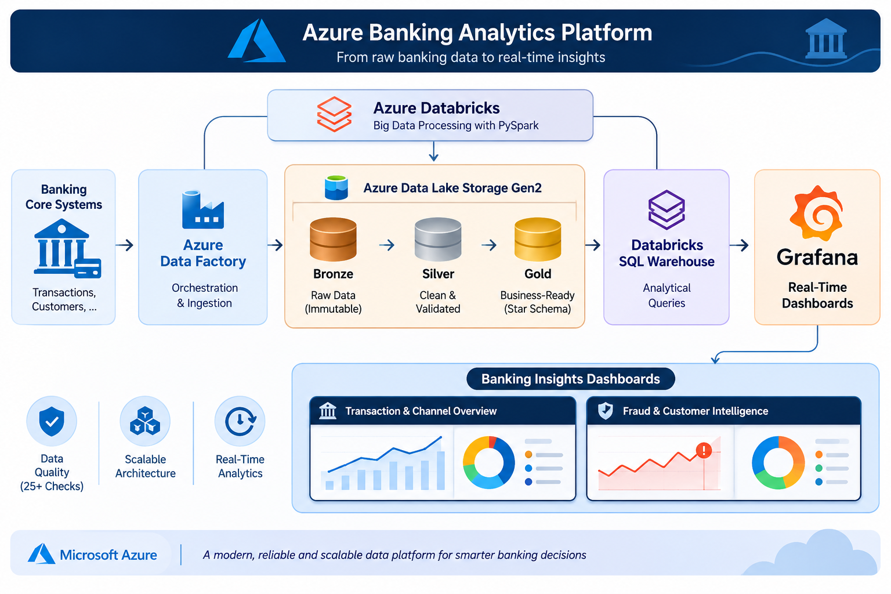
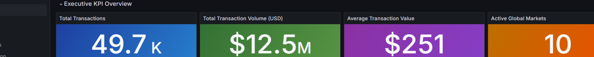
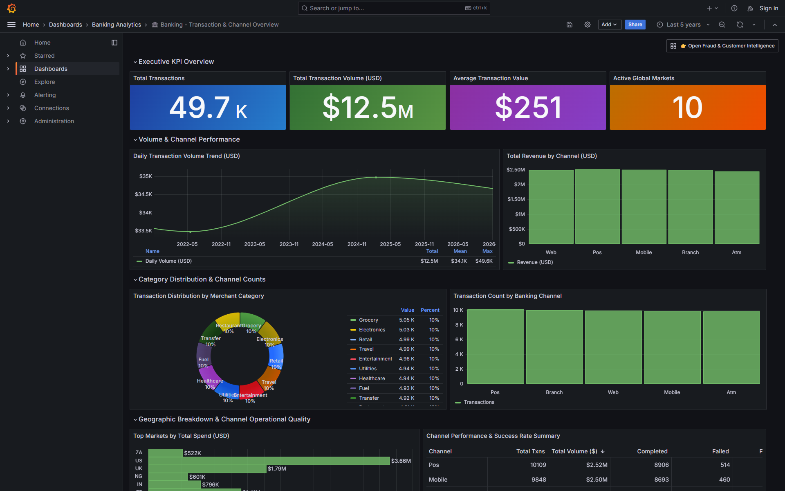
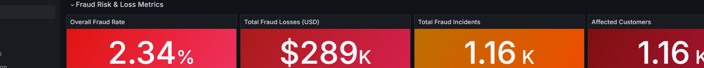
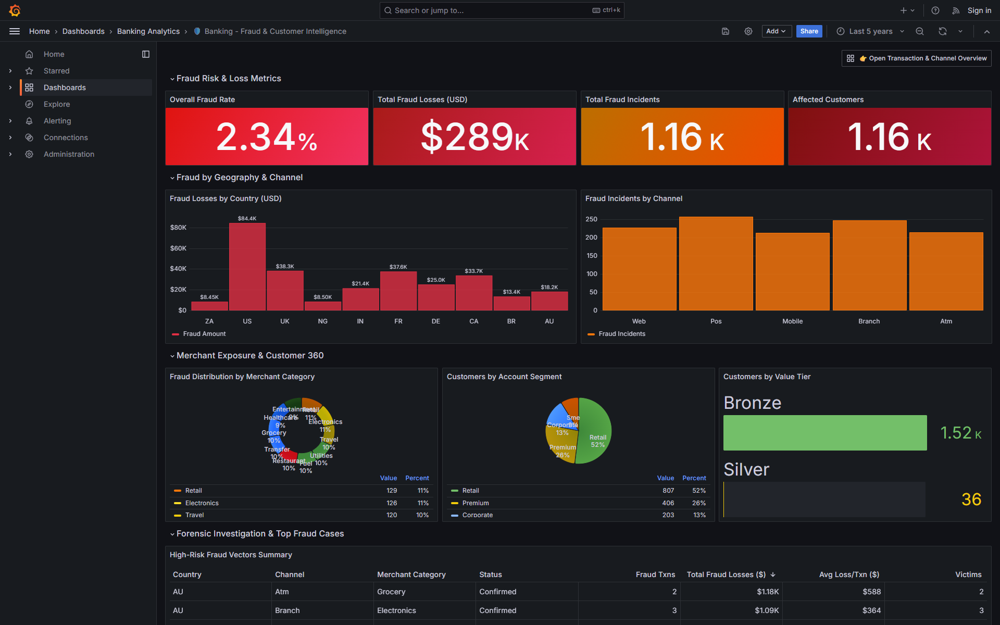

# 🏦 Azure Banking Analytics Platform

<div align="center">


**An end-to-end cloud data engineering and real-time intelligence platform for banking operations, omnichannel performance, and fraud surveillance.**

</div>

---

## 📌 Executive Summary

The **Azure Banking Analytics Platform** is an enterprise data engineering solution built to process, transform, and analyze high-volume banking transactions, customer profiles, and risk vectors. 

Operating on a **Medallion Lakehouse Architecture (Bronze ➔ Silver ➔ Gold)** powered by **Azure Data Factory**, **Azure Data Lake Storage Gen2**, **Azure Databricks (PySpark & Delta Lake)**, and **Databricks SQL**, the platform delivers curated analytical marts directly to **Grafana** for executive monitoring and fraud detection.

---

## 🏛️ System Architecture



### End-to-End Data Pipeline Flow

```
┌────────────────────────┐      ┌─────────────────────────┐      ┌─────────────────────────┐
│  Banking Core Systems  │ ────▶│   Azure Data Factory    │ ────▶│        ADLS Gen2        │
│  (Transactions, Accts) │      │  (PL_Ingest_Banking)    │      │    Bronze Container     │
└────────────────────────┘      └─────────────────────────┘      └────────────┬────────────┘
                                                                              │
                                 ┌────────────────────────────────────────────┘
                                 ▼
                     ┌───────────────────────┐
                     │   Azure Databricks    │  Medallion Pipeline (PySpark / Delta Lake)
                     │                       │  • Bronze: Append-only raw ingestion
                     │   ┌───────────────┐   │  • Silver: Cleansing, Deduplication & SCD2
                     │   │ 25+ DQ Checks │   │  • Gold: Star Schema & Z-Ordered Aggregates
                     │   └───────────────┘   │
                     └───────────┬───────────┘
                                 │
                                 ▼
                     ┌───────────────────────┐
                     │ Databricks SQL Engine │  Low-latency analytical queries
                     └───────────┬───────────┘
                                 │
                                 ▼
                     ┌───────────────────────┐
                     │   Grafana Dashboards  │  Real-Time Executive & Risk Surveillance
                     │  (Dockerized Service) │  • 🏦 Transactions & Channels
                     │                       │  • 🛡️ Fraud & Customer 360
                     └───────────────────────┘
```

---

## 📊 Real-Time Grafana Dashboards

The analytical layer is powered by **Grafana**, delivering live, high-performance executive dashboards connected to curated Gold Delta marts.

### 1. 🏦 Transaction & Channel Overview

> Comprehensive operational surveillance tracking transaction volumes, revenue channels, ticket sizes, and merchant breakdowns.




- **Executive KPIs**: Total Transactions ($49.7\text{K}$), Total Volume ($\$12.5\text{M}$), Average Ticket Size ($\$251$), and Active Global Markets ($10$).
- **Volume Trend Analysis**: Daily volume trajectory with 365-day moving averages and peak spend detection.
- **Omnichannel Performance**: Comparative volume and revenue split across **POS, Mobile, Web, Branch, and ATM** with operational success rates.
- **Merchant Distribution**: Donut chart breakdown across 10 distinct merchant categories (Grocery, Electronics, Travel, etc.).

---

### 2. 🛡️ Fraud & Customer 360 Intelligence

> Advanced risk intelligence tracking real-time fraud velocity, geographic loss exposure, and customer portfolio risk.




- **Risk & Loss KPIs**: Real-time Fraud Rate ($2.34\%$) with multi-level threshold alerts, Total Fraud Losses ($\$289\text{K}$), Incident Count ($1.16\text{K}$), and Impacted Customers.
- **Attack Vector Profiling**: Losses segmented by country (US, UK, FR, DE, CA, etc.) and vulnerable banking channels.
- **Customer 360 Portfolio**: Customer distribution across segments (**Retail 52%**, **Premium 26%**, **Corporate 13%**, **SME**) and value tiers (**Bronze**, **Silver**, **Gold**, **Platinum**).
- **Forensic Investigation Table**: Incident-level log detailing merchant exposure, status confirmation, and average loss per incident for rapid triage.

---

## 🛠️ Technology Stack

| Layer | Technology | Key Capabilities & Responsibility |
| :--- | :--- | :--- |
| **Cloud Provider** | **Microsoft Azure** | Enterprise cloud hosting, RBAC, Key Vault secrets, and networking. |
| **Orchestration** | **Azure Data Factory (ADF)** | Batch pipeline automation, linked services, datasets, and pipeline triggers. |
| **Data Lake Storage** | **ADLS Gen2** | Scalable, hierarchical object storage housing Bronze, Silver, and Gold Delta containers. |
| **Compute & Processing** | **Azure Databricks** | Managed Apache Spark runtime executing medallion transformations. |
| **Distributed Engine** | **Apache Spark / PySpark** | Large-scale parallel transformations, cleansing, joins, and aggregations. |
| **Storage Table Format** | **Delta Lake** | ACID transactions, time travel, schema enforcement, and Z-Order optimization. |
| **Query Engine** | **Databricks SQL Warehouse** | Serverless SQL execution engine powering BI query workloads. |
| **Data Governance** | **Custom Data Quality Framework**| 25+ automated validation rules (null checks, referential integrity, range thresholds). |
| **Dimensional Modeling**| **Star Schema & SCD Type 2** | Slowly Changing Dimensions (Type 2) tracking historical customer profile changes. |
| **Visualization & BI** | **Grafana (v10.4)** | Real-time interactive dashboards with alerting, time series, and custom visual panels. |
| **Containerization** | **Docker & Docker Compose** | Portable, reproducible deployment for the visualization tier. |

---

## 🥉🥈🥇 Medallion Architecture Implementation

### 🥉 Bronze Layer — Raw Ingestion
- **Format:** Delta Lake (append-only)
- **Path:** `/mnt/bronze/banking/`
- **Objective:** Ingest raw transaction logs, customer profiles, accounts, and fraud flags exactly as received from core banking sources with metadata tracking (`ingestion_timestamp`, `source_file`).

### 🥈 Silver Layer — Cleaned, Conformed & Enriched
- **Format:** Delta Lake (partitioned)
- **Path:** `/mnt/silver/banking/`
- **Objective:** 
  - Standardize schemas, cast data types, validate timestamps.
  - Implement **Slowly Changing Dimensions (SCD Type 2)** for customer profile updates (`effective_start_date`, `effective_end_date`, `is_current`).
  - Deduplicate incoming transaction streams.
  - Enforce automated **Data Quality (DQ) validation gates** rejecting anomalies into quarantine tables.

### 🥇 Gold Layer — Business Aggregates & Dimensional Model
- **Format:** Delta Lake (Z-Ordered by date and channel)
- **Path:** `/mnt/gold/banking/`
- **Curated Tables:**
  - `fact_transactions`: High-speed transaction fact table.
  - `agg_daily_txn_summary`: Pre-aggregated daily metrics for instant trend rendering.
  - `agg_channel_performance`: Channel efficiency, volume, and success rate KPIs.
  - `agg_fraud_analysis`: Multidimensional attack vector aggregations.
  - `agg_customer_360`: Unified customer risk and value profiles.

---

## 📂 Repository Structure

```
azure_data_project/
├── adf/                               # Azure Data Factory Artifacts
│   ├── linkedservices/                # Blob, ADLS Gen2, and Databricks Linked Services
│   ├── datasets/                      # Source & Sink dataset definitions
│   └── pipelines/                     # PL_Ingest_Banking_Raw_To_Bronze master pipeline
│
├── databricks/                        # Databricks PySpark Notebooks & Workflows
│   ├── notebooks/
│   │   ├── 01_bronze_ingest.py        # Raw ingestion notebook
│   │   ├── 02_silver_transform.py     # Cleansing, SCD2, and quality enforcement
│   │   ├── 03_gold_aggregations.py    # Analytical data mart aggregation
│   │   └── 04_data_quality_checks.py  # 25+ automated data quality verification rules
│   └── jobs/
│       └── banking_medallion_job.json # Production workflow DAG configuration
│
├── grafana/                           # Production Grafana Visualization Tier
│   ├── dashboards/                    # Provisioned dashboard definitions
│   │   ├── dashboard1_transactions.json
│   │   └── dashboard2_fraud.json
│   ├── provisioning/                  # Automated datasources & dashboard providers
│   ├── docker-compose.yml             # Containerized deployment manifest
│   └── README.md                      # Grafana & Databricks SQL setup guide
│
├── assets/                            # Architecture diagrams & dashboard screenshots
│   ├── diagram.png
│   ├── grafana_transactions_dashboard.png
│   ├── grafana_fraud_dashboard.png
│   ├── kpis_transactions.png
│   └── kpis_fraud.png
│
├── src/                               # Shared Python utilities
└── README.md                          # Master documentation
```

---

## 🚀 Deployment & Usage

### 1. Azure Infrastructure & Databricks Workflows
Deploy ADF pipelines and import Databricks notebooks into your Azure workspace:
```bash
# Databricks workflow executes:
# 01_bronze_ingest -> 02_silver_transform -> 03_gold_aggregations -> 04_data_quality_checks
```

### 2. Launching Grafana Dashboards
The Grafana visualization service runs as an isolated container:
```bash
cd grafana
docker compose up -d
```
Access the dashboards at `http://localhost:3000`:
- **Default Login**: `admin` / `admin123` *(Anonymous Admin access enabled)*
- **Direct Links**:
  - [🏦 Transaction & Channel Overview](http://localhost:3000/d/banking_txn_channel_overview)
  - [🛡️ Fraud & Customer Intelligence](http://localhost:3000/d/banking_fraud_customer_intel)

---

## 📄 License
This project is licensed under the MIT License.
